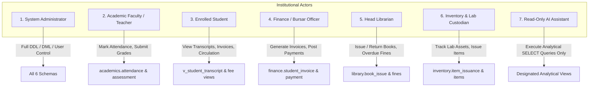
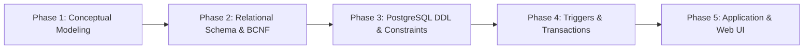
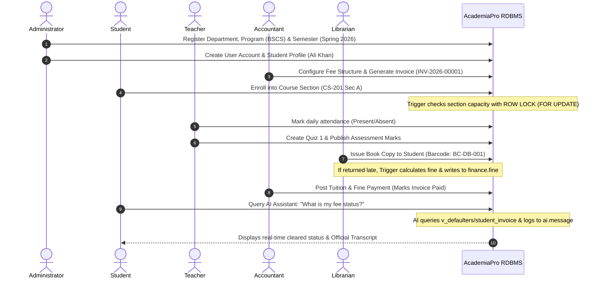
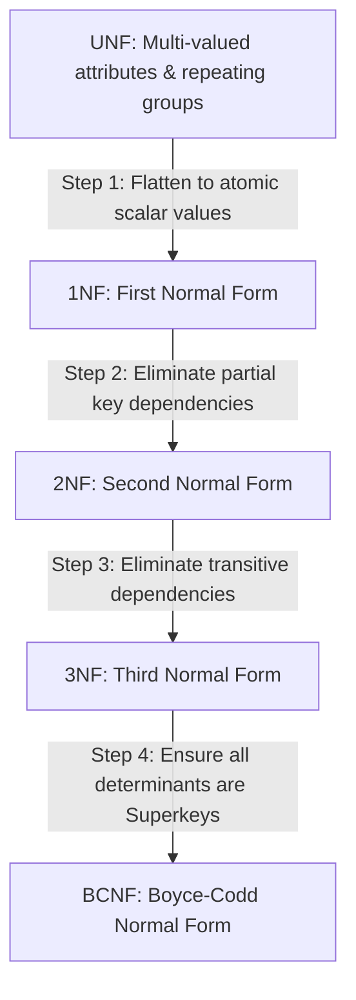

# AcademiaPro: Comprehensive System Specification & Relational Database Design Document

**Project Title:** AcademiaPro - Integrated College Management & Relational Database System  
**Academic Level:** University Semester Project / Enterprise Relational Architecture  
**Target RDBMS:** PostgreSQL 16+ (with SQLite Dual-Engine Compatibility)  
**Application Stack:** Python (Flask), Bootstrap 5, FontAwesome, RESTful JSON APIs  
**Document Classification:** Software Requirements, Relational Theory, & Technical Reference  

---

## Table of Contents
1. [Executive Overview & Design Motivation](#1-executive-overview--design-motivation)
2. [Fundamental Relational Terminology](#2-fundamental-relational-terminology)
3. [System Actors, Roles & Access Hierarchy](#3-system-actors-roles--access-hierarchy)
4. [How the System Was Built (Architectural Methodology)](#4-how-the-system-was-built-architectural-methodology)
5. [How the System Works (End-to-End Operational Lifecycle)](#5-how-the-system-works-end-to-end-operational-lifecycle)
6. [Comprehensive Relational Keys Catalog](#6-comprehensive-relational-keys-catalog)
7. [Formal Functional Dependencies (FDs)](#7-formal-functional-dependencies-fds)
8. [Database Anomalies & Normalization Proof (UNF to BCNF)](#8-database-anomalies--normalization-proof-unf-to-bcnf)
9. [Automated Triggers, Concurrency Control & Stored Procedures](#9-automated-triggers-concurrency-control--stored-procedures)
10. [Analytical Views & Advanced Relational Queries](#10-analytical-views--advanced-relational-queries)
11. [AI Assistant Read-Only Security Protocol](#11-ai-assistant-read-only-security-protocol)
12. [Step-by-Step Setup, Deployment & Terminal Commands Guide](#12-step-by-step-setup-deployment--terminal-commands-guide)

---

## 1. Executive Overview & Design Motivation

Academic institutions operate intricate workflows comprising curricula, section scheduling, student enrollments, exam assessments, tuition accounting, library book circulation, and laboratory inventory tracking. 

In unstructured or poorly designed database systems, these disparate activities are frequently forced into disconnected spreadsheets or unnormalized flat tables. This results in **data redundancy**, **loss of referential integrity**, and severe **operational anomalies**.

**AcademiaPro** addresses these challenges by implementing an enterprise-grade Relational Database Management System (RDBMS) architecture featuring:
* **6 Dedicated Logical Schemas:** `system_core`, `academics`, `finance`, `library`, `inventory`, and `ai`.
* **25 Normalized Relational Entities:** Structured up to **Boyce-Codd Normal Form (BCNF)**.
* **Integrity Constraints:** Complete enforcement of Entity Integrity, Referential Integrity, and Semantic Domain constraints.
* **ACID Transactions & Triggers:** Concurrency-safe section enrollment with row-level locks, automated fine reconciliation, inventory stock deductions, and immutable audit logging.
* **Safe AI Assistant Sandbox:** Strict read-only query execution isolated to predefined analytical views, logging all prompts and generated SQL for forensic monitoring.

---

## 2. Fundamental Relational Terminology

To establish academic rigor, the relational terminology utilized throughout this project is formally defined below:

| Relational Term | Formal Definition | Applied Project Context |
|---|---|---|
| **Relation (Table)** | A mathematical subset of the Cartesian product of a list of attribute domains: $R \subseteq D_1 \times D_2 \times \dots \times D_n$. | E.g., `academics.student`, `finance.student_invoice`. |
| **Tuple (Row / Record)** | An ordered collection of attribute values representing a single real-world entity occurrence. | A specific student instance: `(1, 'BSCS-22-01', 'Ali Khan', ...)`. |
| **Attribute (Column / Field)** | A named characteristic or property defined over a specific data domain. | `credit_hours`, `balance_due`, `isbn`. |
| **Domain ($\text{dom}(A)$)** | The set of permissible, atomic scalar values that an attribute can assume. | $\text{dom}(\text{status}) = \{\text{'Active'}, \text{'Probation'}, \text{'Graduated'}\}$. |
| **Degree of a Relation** | The total number of attributes (columns) constituting a relation schema. | `academics.course` has degree 7. |
| **Cardinality of a Relation** | The total count of tuples (rows) currently residing in the relation. | Total enrolled students count (e.g., 20 rows). |
| **Superkey** | Any set of attributes that uniquely distinguishes each tuple within a relation. | $\{\text{student\_id}, \text{roll\_number}, \text{email}\}$. |
| **Candidate Key (CK)** | A **minimal** superkey such that no proper subset can uniquely identify a tuple. | $\{\text{roll\_number}\}$, $\{\text{cnic}\}$, $\{\text{email}\}$. |
| **Primary Key (PK)** | The candidate key chosen by the database architect as the primary identifier. | `student_id` (Surrogate integer key). |
| **Alternate Key (AK)** | Any candidate key not chosen as the primary key; enforced via `UNIQUE` constraints. | `roll_number`, `cnic`. |
| **Foreign Key (FK)** | An attribute or attribute set in a child relation referencing a Candidate Key in a parent relation. | `student.program_id` referencing `program.program_id`. |
| **Referential Integrity** | The rule dictating that a foreign key value must either match an existing parent key or be NULL. | Enforced with `ON DELETE RESTRICT` / `ON DELETE CASCADE`. |
| **Entity Integrity** | The rule dictating that no component of a Primary Key may be NULL. | Enforced by SQL `PRIMARY KEY` (NOT NULL + UNIQUE). |
| **Functional Dependency ($X \rightarrow Y$)** | A constraint stating that attribute set $X$ uniquely determines the values of attribute set $Y$. | `roll_number` $\rightarrow$ `{first_name, last_name, program_id}`. |
| **Determinant** | The left-hand side ($X$) of a functional dependency $X \rightarrow Y$. | `section_id` in `section_id` $\rightarrow$ `enrolled_count`. |

---

## 3. System Actors, Roles & Access Hierarchy

The system enforces **Role-Based Access Control (RBAC)** across 7 distinct human and automated actors:



### Detailed Actor Responsibilities & Privilege Profiles:

1. **System Administrator (`Admin`):**
   * Manages user accounts, assigns system roles, configures academic semesters, and oversees database maintenance.
   * Holds `ALL PRIVILEGES` across all 6 schemas with full auditing oversight.

2. **Academic Faculty (`Teacher`):**
   * Views assigned course sections, marks lecture attendance daily, defines assessments (quizzes, midterms, projects), and submits student scores.
   * Granted `SELECT` on course catalog, and `INSERT/UPDATE` on `attendance`, `assessment`, and `assessment_result`.

3. **Enrolled Student (`Student`):**
   * Inspects course registrations, tracks degree progress, views official GPA transcripts, checks fee invoice balances, and monitors borrowed library books.
   * Access is strictly isolated to the student's own records via Row-Level Security (RLS) and pre-filtered views.

4. **Finance Officer (`Accountant`):**
   * Configures semester fee tariff structures per degree program, issues student tuition challans/invoices, records bank deposit slips, and audits institutional fee defaulters.
   * Full control over `finance.*` tables and read access to enrolled students.

5. **Head Librarian (`Librarian`):**
   * Catalogs books, tracks physical copies via barcode, manages borrowing quotas (max 3 books per student), processes book returns, and verifies overdue penalty charges.
   * Full access to `library.*` and direct insert capability into `finance.fine`.

6. **Inventory Custodian (`StoreKeeper`):**
   * Manages college equipment categories, tracks asset deployments across departmental computer and engineering labs, monitors minimum reorder stock thresholds, and logs purchase receipts.
   * Full management authority over `inventory.*`.

7. **AI Assistant (`AI_Agent`):**
   * An automated natural language assistant answering user queries (e.g., *"What is my semester fee status?"* or *"List all low stock items"*).
   * **Crucial Security Restriction:** Granted **ZERO** write permissions. It can only execute `SELECT` against analytical views. Every request is recorded in `ai.message` with execution status and response summary.

---

## 4. How the System Was Built (Architectural Methodology)

AcademiaPro was constructed following a 5-tier engineering methodology:



### 1. Conceptual Domain Modeling
* Identified business boundaries from academic lectures: Separation of Programs from Courses, decoupling Assessments from Results, bridging Library Fines into Finance, and linking Inventory to Physical Departmental Rooms and Labs.

### 2. Formal Normalization
* Modeled the entire data universe starting from an unnormalized relation (UNF), identifying functional dependencies, and systematically decomposing entities to satisfy **1NF**, **2NF**, **3NF**, and **Boyce-Codd Normal Form (BCNF)** without loss of dependency.

### 3. PostgreSQL Native Schema Implementation
* Segregated database objects into 6 distinct namespaces (schemas).
* Specified data types, composite primary keys, foreign key referential actions (`ON DELETE RESTRICT` for financial and academic safety, `ON DELETE CASCADE` for dependent results), `CHECK` constraints, and performance indexes.

### 4. Reliability, Triggers & Concurrency Safeguards
* Authored PL/pgSQL triggers to handle race conditions during section seat booking, automatically calculate overdue library fines upon book return, deduct inventory stock upon issuance, and log sensitive mutations into `system_core.audit_log`.

### 5. Application Layer & Dual Database Engine
* Developed an asynchronous web server in Python (Flask) featuring an abstract database manager capable of querying PostgreSQL 16+ or fallback SQLite seamlessly without altering SQL dialect semantics.
* Designed a responsive UI using Bootstrap 5, FontAwesome, interactive data tables, a live SQL execution playground, and an AI chat interface.

---

## 5. How the System Works (End-to-End Operational Lifecycle)

The following sequence illustrates the operational workflow from student admission to degree audit:



### Stage-by-Stage Workflow Details:

1. **Academic Setup:** Department heads create course offerings and assign sections to faculty members.
2. **Transactional Enrollment & Invoicing:** When a student registers for semester sections, stored procedure `sp_register_student_with_fee_voucher` atomically binds the enrollments and constructs the corresponding semester fee invoice in a single `COMMIT` boundary.
3. **Daily Instruction & Attendance:** Faculty record lecture attendance. A computed view (`v_attendance_shortage`) evaluates the institution's mandatory 75% attendance policy. Any student falling below 75% is dynamically flagged as `DEBARRED_FROM_FINAL_EXAM`.
4. **Circulation & Cross-Module Fine Integration:** When a borrowed book is checked back into the library past its due date, trigger `trg_sync_library_fine` automatically computes the penalty ($\text{days} \times \text{PKR } 10$) and immediately inserts a fine invoice into `finance.fine`.
5. **Asset Tracking:** Storekeepers allocate lab computers and hardware to specific rooms (e.g., `Lab-A1`). Stock levels automatically decrement via trigger `trg_deduct_inventory_stock`. When stock dips below `min_reorder_level`, alert view `v_low_stock` triggers procurement notices.

---

## 6. Comprehensive Relational Keys Catalog

Below is the definitive catalog of all keys implemented across the 25 relations in AcademiaPro:

| Schema | Table Name | Primary Key (PK) | Candidate Keys (CK) | Alternate Keys (AK) | Foreign Keys (FK) & Parent Reference |
|---|---|---|---|---|---|
| `system_core` | `role` | `role_id` | `{role_id}`, `{role_name}` | `role_name` | None |
| `system_core` | `user_account` | `user_id` | `{user_id}`, `{username}`, `{email}` | `username`, `email` | None |
| `system_core` | `user_role` | `(user_id, role_id)` | `{user_id, role_id}` | None (Composite PK) | `user_id &rarr; user_account`<br>`role_id &rarr; role` |
| `system_core` | `audit_log` | `log_id` | `{log_id}` | None | `user_id &rarr; user_account` |
| `academics` | `department` | `dept_id` | `{dept_id}`, `{dept_code}`, `{dept_name}` | `dept_code`, `dept_name` | None |
| `academics` | `program` | `program_id` | `{program_id}`, `{program_code}` | `program_code` | `dept_id &rarr; department` |
| `academics` | `semester` | `semester_id` | `{semester_id}`, `{term_name, academic_year}` | `(term_name, academic_year)` | None |
| `academics` | `teacher` | `teacher_id` | `{teacher_id}`, `{employee_code}`, `{user_id}`, `{email}` | `employee_code`, `email` | `user_id &rarr; user_account`<br>`dept_id &rarr; department` |
| `academics` | `student` | `student_id` | `{student_id}`, `{roll_number}`, `{user_id}`, `{cnic}`, `{email}` | `roll_number`, `cnic`, `email` | `user_id &rarr; user_account`<br>`program_id &rarr; program` |
| `academics` | `course` | `course_id` | `{course_id}`, `{course_code}` | `course_code` | `program_id &rarr; program` |
| `academics` | `section` | `section_id` | `{section_id}`, `{course_id, semester_id, section_name}` | `(course_id, semester_id, section_name)` | `course_id &rarr; course`<br>`semester_id &rarr; semester`<br>`teacher_id &rarr; teacher` |
| `academics` | `enrollment` | `enrollment_id` | `{enrollment_id}`, `{student_id, section_id}` | `(student_id, section_id)` | `student_id &rarr; student`<br>`section_id &rarr; section` |
| `academics` | `attendance` | `attendance_id` | `{attendance_id}`, `{enrollment_id, lecture_date}` | `(enrollment_id, lecture_date)` | `enrollment_id &rarr; enrollment` |
| `academics` | `assessment` | `assessment_id` | `{assessment_id}` | None | `section_id &rarr; section` |
| `academics` | `assessment_result` | `result_id` | `{result_id}`, `{assessment_id, enrollment_id}` | `(assessment_id, enrollment_id)` | `assessment_id &rarr; assessment`<br>`enrollment_id &rarr; enrollment` |
| `finance` | `fee_structure` | `fee_structure_id` | `{fee_structure_id}`, `{program_id, semester_id}` | `(program_id, semester_id)` | `program_id &rarr; program`<br>`semester_id &rarr; semester` |
| `finance` | `student_invoice` | `invoice_id` | `{invoice_id}`, `{invoice_number}`, `{student_id, semester_id}` | `invoice_number`, `(student_id, semester_id)` | `student_id &rarr; student`<br>`semester_id &rarr; semester`<br>`fee_structure_id &rarr; fee_structure` |
| `finance` | `fee_payment` | `payment_id` | `{payment_id}`, `{payment_reference}` | `payment_reference` | `invoice_id &rarr; student_invoice`<br>`received_by_user_id &rarr; user_account` |
| `finance` | `fine` | `fine_id` | `{fine_id}` | None | `student_id &rarr; student` |
| `library` | `book` | `book_id` | `{book_id}`, `{isbn}` | `isbn` | None |
| `library` | `book_copy` | `copy_id` | `{copy_id}`, `{barcode}` | `barcode` | `book_id &rarr; book` |
| `library` | `library_member` | `member_id` | `{member_id}`, `{membership_number}`, `{user_id}` | `membership_number` | `user_id &rarr; user_account` |
| `library` | `book_issue` | `issue_id` | `{issue_id}` | None | `copy_id &rarr; book_copy`<br>`member_id &rarr; library_member` |
| `inventory` | `item_category` | `category_id` | `{category_id}`, `{category_name}` | `category_name` | None |
| `inventory` | `room_lab` | `room_id` | `{room_id}`, `{dept_id, room_number}` | `(dept_id, room_number)` | `dept_id &rarr; department` |
| `inventory` | `inventory_item` | `item_id` | `{item_id}`, `{item_code}` | `item_code` | `category_id &rarr; item_category` |
| `inventory` | `purchase_order` | `po_id` | `{po_id}`, `{po_number}` | `po_number` | `ordered_by_user_id &rarr; user_account` |
| `inventory` | `purchase_item` | `po_item_id` | `{po_item_id}`, `{po_id, item_id}` | `(po_id, item_id)` | `po_id &rarr; purchase_order`<br>`item_id &rarr; inventory_item` |
| `inventory` | `item_issuance` | `issuance_id` | `{issuance_id}` | None | `item_id &rarr; inventory_item`<br>`room_id &rarr; room_lab`<br>`issued_to_user_id &rarr; user_account` |
| `ai` | `conversation` | `conversation_id` | `{conversation_id}` | None | `user_id &rarr; user_account` |
| `ai` | `message` | `message_id` | `{message_id}` | None | `conversation_id &rarr; conversation`<br>`user_id &rarr; user_account` |

---

## 7. Formal Functional Dependencies (FDs)

A Functional Dependency $X \rightarrow Y$ holds over relation $R$ if for all pairs of tuples $t_1, t_2 \in R$, $t_1[X] = t_2[X] \implies t_1[Y] = t_2[Y]$.

Below are the explicit functional dependencies governing each domain:

### 1. `academics.department`
* $\text{dept\_id} \rightarrow \{\text{dept\_code, dept\_name, office\_location, contact\_email}\}$
* $\text{dept\_code} \rightarrow \{\text{dept\_id, dept\_name, office\_location, contact\_email}\}$
* $\text{dept\_name} \rightarrow \{\text{dept\_id, dept\_code, office\_location, contact\_email}\}$

### 2. `academics.program`
* $\text{program\_id} \rightarrow \{\text{dept\_id, program\_code, program\_name, degree\_level, total\_semesters, total\_credits}\}$
* $\text{program\_code} \rightarrow \{\text{program\_id, dept\_id, program\_name, degree\_level, total\_semesters, total\_credits}\}$

### 3. `academics.semester`
* $\text{semester\_id} \rightarrow \{\text{term\_name, academic\_year, start\_date, end\_date, is\_current}\}$
* $\{\text{term\_name, academic\_year}\} \rightarrow \{\text{semester\_id, start\_date, end\_date, is\_current}\}$

### 4. `academics.teacher`
* $\text{teacher\_id} \rightarrow \{\text{employee\_code, user\_id, dept\_id, first\_name, last\_name, email, phone, designation, qualification, hire\_date}\}$
* $\text{employee\_code} \rightarrow \{\text{teacher\_id, user\_id, dept\_id, first\_name, last\_name, email, \dots}\}$
* $\text{user\_id} \rightarrow \{\text{teacher\_id, employee\_code, \dots}\}$

### 5. `academics.student`
* $\text{student\_id} \rightarrow \{\text{roll\_number, user\_id, program\_id, first\_name, last\_name, email, cnic, phone, date\_of\_birth, admission\_date, current\_semester\_num, status}\}$
* $\text{roll\_number} \rightarrow \{\text{student\_id, user\_id, program\_id, first\_name, \dots}\}$
* $\text{cnic} \rightarrow \{\text{student\_id, roll\_number, \dots}\}$
* $\text{email} \rightarrow \{\text{student\_id, roll\_number, \dots}\}$

### 6. `academics.course`
* $\text{course\_id} \rightarrow \{\text{program\_id, course\_code, title, credit\_hours, is\_lab\_required, description}\}$
* $\text{course\_code} \rightarrow \{\text{course\_id, program\_id, title, credit\_hours, is\_lab\_required, description}\}$

### 7. `academics.section`
* $\text{section\_id} \rightarrow \{\text{course\_id, semester\_id, teacher\_id, section\_name, max\_capacity, enrolled\_count, room\_number}\}$
* $\{\text{course\_id, semester\_id, section\_name}\} \rightarrow \{\text{section\_id, teacher\_id, max\_capacity, enrolled\_count, room\_number}\}$

### 8. `academics.enrollment`
* $\text{enrollment\_id} \rightarrow \{\text{student\_id, section\_id, enrollment\_date, status, final\_grade, gpa\_points}\}$
* $\{\text{student\_id, section\_id}\} \rightarrow \{\text{enrollment\_id, enrollment\_date, status, final\_grade, gpa\_points}\}$

### 9. `academics.assessment` & `assessment_result`
* $\text{assessment\_id} \rightarrow \{\text{section\_id, title, assessment\_type, max\_marks, weightage\_percent, due\_date}\}$
* $\text{result\_id} \rightarrow \{\text{assessment\_id, enrollment\_id, marks\_obtained, remarks, graded\_at}\}$
* $\{\text{assessment\_id, enrollment\_id}\} \rightarrow \{\text{result\_id, marks\_obtained, remarks, graded\_at}\}$

### 10. `finance.fee_structure` & `student_invoice`
* $\{\text{program\_id, semester\_id}\} \rightarrow \{\text{tuition\_fee, lab\_fee, library\_fund, exam\_fee, total\_structure\_amount}\}$
* $\text{invoice\_id} \rightarrow \{\text{invoice\_number, student\_id, semester\_id, fee\_structure\_id, total\_amount, paid\_amount, balance\_due, issue\_date, due\_date, status}\}$
* $\{\text{student\_id, semester\_id}\} \rightarrow \{\text{invoice\_id, invoice\_number, total\_amount, balance\_due, \dots}\}$

### 11. `library.book` & `book_copy`
* $\text{book\_id} \rightarrow \{\text{isbn, title, author, publisher, publication\_year, category}\}$
* $\text{isbn} \rightarrow \{\text{book\_id, title, author, publisher, publication\_year, category}\}$
* $\text{copy\_id} \rightarrow \{\text{book\_id, barcode, edition, shelf\_location, status}\}$
* $\text{barcode} \rightarrow \{\text{copy\_id, book\_id, edition, shelf\_location, status}\}$

### 12. `inventory.room_lab` & `inventory_item`
* $\{\text{dept\_id, room\_number}\} \rightarrow \{\text{room\_id, room\_name, room\_type, capacity}\}$
* $\text{item\_id} \rightarrow \{\text{category\_id, item\_code, item\_name, unit\_of\_measure, total\_stock, available\_stock, min\_reorder\_level}\}$
* $\text{item\_code} \rightarrow \{\text{item\_id, category\_id, item\_name, unit\_of\_measure, total\_stock, available\_stock, min\_reorder\_level}\}$

---

## 8. Database Anomalies & Normalization Proof (UNF to BCNF)

### 8.1 The Unnormalized Flat Design (UNF)
Consider a naive unnormalized table storing academic records:
$$\text{UNF\_COLLEGE}(\underline{\text{roll\_no}}, \text{student\_name}, \text{phone\_numbers}, \text{dept\_code}, \text{dept\_name}, \text{dept\_office}, \underline{\text{course\_code}}, \text{course\_title}, \text{teacher\_code}, \text{teacher\_name}, \text{teacher\_office}, \text{grade})$$

### 8.2 The Three Crippling Relational Anomalies:

1. **Insertion Anomaly:**
   * *Scenario:* The university hires a distinguished professor (`Dr. Usman Ali`, Department of AI) or opens a new Department of Data Science in `Block D`.
   * *Failure in UNF:* The composite primary key requires both `roll_no` and `course_code`. Because no student has enrolled yet, `roll_no` is NULL. Under the **Entity Integrity Rule**, primary key attributes cannot be NULL. Therefore, the institution cannot record the new professor or department without inserting a fictitious dummy student!
   * *Resolution in AcademiaPro:* `teacher` and `department` are decomposed into independent relations. New faculty and departments can be inserted anytime regardless of student enrollments.

2. **Deletion Anomaly:**
   * *Scenario:* Only one student (`Daniyal Mir`) is enrolled in an elective course `AI-401` taught by `Dr. Farooq Azam`. Student Daniyal withdraws from university, requiring his tuple to be deleted.
   * *Failure in UNF:* Deleting Daniyal's row inadvertently purges the course definition `AI-401`, Professor Farooq's employee record, and his department affiliation from the database completely!
   * *Resolution in AcademiaPro:* Deleting an `academics.enrollment` tuple retains the underlying `student`, `course`, and `teacher` records completely unharmed.

3. **Update / Modification Anomaly:**
   * *Scenario:* Professor `Dr. Tariq Mahmood` shifts his office from `Block A-201` to `Block A-310`.
   * *Failure in UNF:* His office location is duplicated across 1,500 enrolled student tuples. If an SQL update modifies 1,495 rows and terminates prematurely, Dr. Tariq simultaneously has two contradictory offices in the system.
   * *Resolution in AcademiaPro:* His office is stored in **exactly one tuple** in `academics.teacher`. A single-row atomic update guarantees 100% global consistency.

---

### 8.3 Step-by-Step Normalization Proof



#### Step 1: Transformation to First Normal Form (1NF)
* **Rule:** A relation is in 1NF if every attribute domain contains only atomic, indivisible values, and there are no repeating groups or multi-valued fields.
* **Action:** Flatten composite names (`first_name`, `last_name`), decompose multi-valued telephone lists into single atomic values, and enforce primary keys across every relation.

#### Step 2: Transformation to Second Normal Form (2NF)
* **Rule:** A relation is in 2NF if it is in 1NF and contains **no partial functional dependencies** (i.e., no non-prime attribute is functionally dependent on a proper subset of any composite candidate key).
* **Action:** In composite relation $R(\underline{\text{student\_id, section\_id}}, \text{enrollment\_date}, \text{grade}, \text{course\_title}, \text{max\_capacity})$:
  * $\{\text{student\_id, section\_id}\} \rightarrow \{\text{enrollment\_date, grade}\}$ (Full functional dependency).
  * $\text{section\_id} \rightarrow \{\text{course\_title, max\_capacity}\}$ (**Partial Dependency** violating 2NF).
  * **Decomposition:** Split into `enrollment(enrollment_id, student_id, section_id, grade)` and `section(section_id, course_id, max_capacity)`. Now all non-prime attributes depend upon the complete key.

#### Step 3: Transformation to Third Normal Form (3NF)
* **Rule:** A relation is in 3NF if it is in 2NF and contains **no transitive dependencies** for non-prime attributes ($X \rightarrow Y$ and $Y \rightarrow Z$ where $Z$ is non-prime and $Y$ is not a superkey).
* **Action:** Consider: $\text{student}(\underline{\text{student\_id}}, \text{roll\_no}, \text{name}, \text{program\_id}, \text{program\_name}, \text{dept\_name})$.
  * Here: $\text{student\_id} \rightarrow \text{program\_id}$ and $\text{program\_id} \rightarrow \text{dept\_name}$.
  * Thus: $\text{student\_id} \xrightarrow{\text{transitive}} \text{dept\_name}$.
  * **Decomposition:** Split into `student(student_id, roll_no, program_id)`, `program(program_id, dept_id, program_name)`, and `department(dept_id, dept_name)`. Every attribute now directly and non-transitively depends upon the primary key.

#### Step 4: Verification of Boyce-Codd Normal Form (BCNF)
* **Rule:** A relation $R$ is in BCNF if and only if for every non-trivial functional dependency $X \rightarrow Y$, the determinant $X$ is a **Superkey** of $R$.
* **Proof for AcademiaPro:**
  * In `academics.section`: The determinants are `section_id` (PK) and `{course_id, semester_id, section_name}` (AK). Both are superkeys.
  * In `library.book_copy`: The determinants are `copy_id` (PK) and `barcode` (AK). Both are superkeys.
  * In `finance.student_invoice`: The determinants are `invoice_id` (PK), `invoice_number` (AK), and `{student_id, semester_id}` (AK). All are superkeys.
  * **Conclusion:** Every determinant across all 25 tables in AcademiaPro is a candidate superkey. Therefore, the database is mathematically certified **in BCNF**.

---

## 9. Automated Triggers, Concurrency Control & Stored Procedures

To ensure reliability (Teacher Stage 7), AcademiaPro deploys automated database triggers and transactional stored procedures:

### 1. Concurrency-Safe Section Enrollment Trigger (`trg_check_enrollment_capacity`)
* **Problem:** If two students simultaneously attempt to register for the final remaining seat in Section A, race conditions could lead to oversubscription beyond classroom capacity.
* **Enforcement:** In PL/pgSQL function `academics.fn_check_section_capacity_and_increment()`, the database issues `SELECT max_capacity, enrolled_count FROM academics.section WHERE section_id = NEW.section_id FOR UPDATE;`.
* **Behavior:** An exclusive row lock is held on the section record. If `enrolled_count >= max_capacity`, the transaction raises an exception and aborts. Otherwise, it increments `enrolled_count` atomically.

### 2. Cross-Module Overdue Library Fine Trigger (`trg_sync_library_fine`)
* **Enforcement:** Executes `BEFORE UPDATE ON library.book_issue`.
* **Behavior:** When a book is marked returned (`NEW.return_date IS NOT NULL`) and `return_date > due_date`:
  1. Calculates: $\text{Overdue Days} \times \text{PKR } 10.00$.
  2. Updates `book_copy.status = 'Available'`.
  3. Inserts a new pending penalty record directly into `finance.fine` linked to the student ID with source reference `'ISSUE-' || issue_id`.

### 3. Inventory Stock Deduction Trigger (`trg_deduct_inventory_stock`)
* **Enforcement:** Executes `BEFORE INSERT ON inventory.item_issuance`.
* **Behavior:** Locks the inventory item row (`FOR UPDATE`), checks whether `available_stock >= NEW.quantity`. If sufficient, atomically decrements `available_stock`. If insufficient, raises an exception preventing inventory deficit.

### 4. Forensic Audit Trail Logger Trigger (`trg_audit_enrollment_changes`)
* **Enforcement:** Executes `AFTER UPDATE OR DELETE ON academics.enrollment`.
* **Behavior:** Serializes old and new tuple states into `JSONB` and logs the transaction operator, schema name, table name, record ID, and timestamp into `system_core.audit_log`.

### 5. Transactional Registration Procedure (`sp_register_student_with_fee_voucher`)
* **Behavior:** Wraps multi-course section enrollment and semester fee voucher generation into an atomic transaction (`COMMIT / ROLLBACK`), guaranteeing that a student is never enrolled without an accompanying billing invoice.

---

## 10. Analytical Views & Advanced Relational Queries

### 10.1 Production Analytical Views

1. **`academics.v_student_transcript`**:
   Joins students, degree programs, courses, sections, and enrollments to produce cumulative transcripts with credit hours, letter grades, GPA points, and quality points.
2. **`finance.v_defaulters`**:
   Consolidates outstanding invoice balances with unpaid library/discipline fines to identify students with pending institutional holds.
3. **`inventory.v_low_stock`**:
   Identifies items where `available_stock <= min_reorder_level` along with deployed room locations and shortage quantities.
4. **`library.v_overdue_books`**:
   Lists active borrowings exceeding their due dates with borrower names, days overdue, and dynamically accrued fine amounts.
5. **`academics.v_attendance_shortage`**:
   Evaluates student attendance against total lectures held. Dynamically flags students below 75% as `DEBARRED_FROM_FINAL_EXAM`.

### 10.2 Complex Relational Queries (Intelligence Tier)

* **Relational Division ($S \div C$):**
  Identifies students who have enrolled in **all** core Computer Science courses offered in the semester using double negation (`NOT EXISTS ... EXCEPT`).
* **Set Difference (`EXCEPT`):**
  Extracts active students who have never borrowed any book from the library.
* **Aggregation with `HAVING`:**
  Finds sections where the average student assessment mark is below 70% with at least 3 students evaluated.
* **Window Analytic Functions (`DENSE_RANK()`):**
  Computes semester GPAs and assigns departmental academic rank partitioned by degree program.
* **Common Table Expressions (CTE):**
  Estimates procurement budget deficits for inventory items falling below safety reorder levels.

---

## 11. AI Assistant Read-Only Security Protocol

### Design Risk Addressed:
Allowing an automated AI assistant direct write access to a database poses fatal risks of SQL injection, accidental truncation, or unauthorized grade modifications.

### Security Implementation:
1. **Isolated Database Role:** The AI assistant operates under `acad_ai_readonly_role`. All `INSERT`, `UPDATE`, `DELETE`, and `DROP` privileges are explicitly revoked.
2. **View-Only Access:** The assistant is granted `SELECT` access exclusively to designated analytical views (`v_student_transcript`, `v_defaulters`, `v_low_stock`, `v_overdue_books`, `v_attendance_shortage`).
3. **Application-Level Interception:**
   ```python
   # apps/database_engine.py
   forbidden_keywords = ['INSERT', 'UPDATE', 'DELETE', 'DROP', 'ALTER', 'TRUNCATE', 'GRANT', 'REVOKE']
   for kw in forbidden_keywords:
       if upper_sql.startswith(kw) or f" {kw} " in upper_sql:
           return {"success": False, "error": "Security Violation: Only SELECT permitted."}
   ```
4. **Immutable Audit Footprint:** Every inquiry logs `user_id`, `user_role`, `user_query`, `generated_sql`, `execution_status`, `row_count_returned`, and `timestamp` into `ai.message`.

---

## 12. Step-by-Step Setup, Deployment & Terminal Commands Guide

### Prerequisites
* Python 3.10+ installed
* Modern Web Browser (Chrome, Edge, Firefox)
* Optional: PostgreSQL 16+ server

---

### Step 1: Open VS Code Terminal
1. Open Visual Studio Code.
2. Press <kbd>Ctrl</kbd> + <kbd>`</kbd> (or go to **Terminal ➔ New Terminal**).

### Step 2: Navigate to Project Directory
```powershell
cd "C:\Users\Sana Hameed Hacker\.gemini\antigravity\scratch\college_management_system"
```

### Step 3: Install Dependencies
```powershell
pip install -r requirements.txt
```

### Step 4: Initialize the Database (One-Click Setup)
```powershell
python database\init_db.py
```
*Output Confirmation:*
```
==================================================
AcademiaPro Unified Database Setup Utility
==================================================
[*] Initializing SQLite Database at: ...\academiapro.db
[+] SQLite database successfully initialized with all tables, views, and sample data!
[+] Setup complete!
```

### Step 5: Run Automated Verification Tests
```powershell
python test_app.py
```
*Output Confirmation:*
```
Testing route /                    -> Status 200
Testing route /academics           -> Status 200
Testing route /finance             -> Status 200
Testing route /library             -> Status 200
Testing route /inventory           -> Status 200
Testing route /ai-assistant        -> Status 200
Testing route /security-audit      -> Status 200
Testing route /theory-docs         -> Status 200
Testing route /query-runner        -> Status 200

[SUCCESS] All routes rendered with HTTP 200 OK!
--- Testing API Endpoints ---
AI Query Response Status: 200 Data: Query executed successfully returning 1 row(s).
Malicious Query Interception: REJECTED_SECURITY Message: Security Violation...
SQL Runner Status: 200 Rows: [{'count': 11}]
```

### Step 6: Start the Application Server
```powershell
python app\app.py
```

### Step 7: Access the System in Browser
Open your browser and navigate to:
👉 **`http://127.0.0.1:5000`**

---

### Native PostgreSQL Terminal Execution (Optional Submission Requirement)
If your professor requests executing the scripts directly inside PostgreSQL:
```powershell
& "C:\Program Files\PostgreSQL\18\bin\psql.exe" -U postgres -d postgres -f database\01_schema_ddl.sql
& "C:\Program Files\PostgreSQL\18\bin\psql.exe" -U postgres -d postgres -f database\02_views.sql
& "C:\Program Files\PostgreSQL\18\bin\psql.exe" -U postgres -d postgres -f database\03_triggers_and_procedures.sql
& "C:\Program Files\PostgreSQL\18\bin\psql.exe" -U postgres -d postgres -f database\04_sample_data.sql
& "C:\Program Files\PostgreSQL\18\bin\psql.exe" -U postgres -d postgres -f database\05_complex_queries.sql
& "C:\Program Files\PostgreSQL\18\bin\psql.exe" -U postgres -d postgres -f database\06_dcl_roles_and_security.sql
```

---
**Document Status:** Complete & Verified  
**Author:** Academic Project Lead  
**Submission Ready:** Yes
