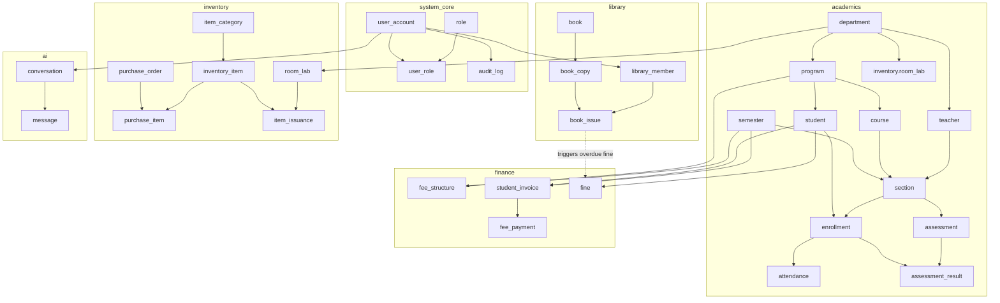

# Relational Model, Functional Dependencies & Normalization Specification
**Project:** AcademiaPro - Integrated College Management System  
**Academic Module:** Database Systems & Relational Theory  
**Target RDBMS:** PostgreSQL 16+ / SQLite Dual-Engine  

---

## 1. Mathematical Relational Foundation

A relational database is formally modeled as a collection of relations defined over domain sets.

### 1.1 Formal Sets & Domains
Let the fundamental domain sets be defined as:
* $D_{ID} = \mathbb{Z}^+$ (Positive integers for surrogates/identifiers)
* $D_{CODE} = \{ s \in \Sigma^* \mid \text{length}(s) \le 20 \}$ (Alphanumeric codes e.g., 'CS-101', 'FALL-2026')
* $D_{NAME} = \{ s \in \Sigma^* \mid \text{length}(s) \le 150 \}$ (Character strings for names)
* $D_{EMAIL} = \{ s \in \Sigma^* \mid s \text{ complies with RFC 5322 regex} \}$
* $D_{MONEY} = \{ x \in \mathbb{R} \mid x \ge 0.00 \text{ with 2 decimal places} \}$
* $D_{STATUS} = \{ \text{'Active'}, \text{'Inactive'}, \text{'Suspended'}, \text{'Graduated'}, \text{'Paid'}, \text{'Unpaid'}, \text{'Partial'} \}$
* $D_{ROLE} = \{ \text{'Admin'}, \text{'Teacher'}, \text{'Student'}, \text{'Accountant'}, \text{'Librarian'}, \text{'StoreKeeper'}, \text{'AI_Agent'} \}$
* $D_{TERM} = \{ \text{'Fall'}, \text{'Spring'}, \text{'Summer'} \}$
* $D_{GRADE} = \{ \text{'A'}, \text{'B+'}, \text{'B'}, \text{'C+'}, \text{'C'}, \text{'D'}, \text{'F'}, \text{'I'} \}$

### 1.2 Cartesian Products and Relations
For a relation schema $R(A_1, A_2, \dots, A_n)$ where each attribute $A_i$ has domain $\text{dom}(A_i)$:
$$R \subseteq \text{dom}(A_1) \times \text{dom}(A_2) \times \dots \times \text{dom}(A_n)$$

* **Enrollment Relation:**
  $$\text{ENROLLMENT} \subseteq D_{ID} \times D_{ID} \times D_{DATE} \times D_{STATUS} \times D_{GRADE}$$
  Representing the Cartesian mapping: $\text{STUDENT} \times \text{SECTION} \rightarrow \text{GRADE} \times \text{STATUS}$.

* **Assessment Result Relation:**
  $$\text{ASSESSMENT\_RESULT} \subseteq D_{ID} \times D_{ID} \times D_{ID} \times \mathbb{R}^+ \times \text{Text}$$
  Representing: $\text{ENROLLMENT} \times \text{ASSESSMENT} \rightarrow \text{SCORE}$.

---

## 2. Relational Schema Architecture & Integrity Constraints

The system is partitioned into 6 distinct logical schemas:

---

## 3. Entity Classification, Keys, and Functional Dependencies

Below is the rigorous formalization of every relation, its Candidate Keys (CK), Primary Key (PK), Alternate Keys (AK), Foreign Keys (FK), and Functional Dependencies (FD).

### 3.1 `academics.department`
* **Attributes:** `(dept_id, dept_code, dept_name, office_location, contact_email)`
* **Candidate Keys:** $\{ \text{dept\_id} \}, \{ \text{dept\_code} \}, \{ \text{dept\_name} \}$
* **Primary Key:** `dept_id`
* **Alternate Keys:** `dept_code`, `dept_name`
* **Functional Dependencies:**
  * $\text{dept\_id} \rightarrow \text{dept\_code, dept\_name, office\_location, contact\_email}$
  * $\text{dept\_code} \rightarrow \text{dept\_id, dept\_name, office\_location, contact\_email}$
  * $\text{dept\_name} \rightarrow \text{dept\_id, dept\_code, office\_location, contact\_email}$

### 3.2 `academics.program`
* **Attributes:** `(program_id, dept_id, program_code, program_name, total_semesters, total_credits)`
* **Candidate Keys:** $\{ \text{program\_id} \}, \{ \text{program\_code} \}$
* **Primary Key:** `program_id`
* **Foreign Key:** `dept_id` $\rightarrow$ `academics.department(dept_id)`
* **Functional Dependencies:**
  * $\text{program\_id} \rightarrow \text{dept\_id, program\_code, program\_name, total\_semesters, total\_credits}$
  * $\text{program\_code} \rightarrow \text{program\_id, dept\_id, program\_name, total\_semesters, total\_credits}$

### 3.3 `academics.semester`
* **Attributes:** `(semester_id, term_name, academic_year, start_date, end_date, is_current)`
* **Candidate Keys:** $\{ \text{semester\_id} \}, \{ \text{term\_name, academic\_year} \}$
* **Primary Key:** `semester_id`
* **Alternate Key:** `(term_name, academic_year)`
* **Functional Dependencies:**
  * $\text{semester\_id} \rightarrow \text{term\_name, academic\_year, start\_date, end\_date, is\_current}$
  * $\text{term\_name, academic\_year} \rightarrow \text{semester\_id, start\_date, end\_date, is\_current}$

### 3.4 `academics.student`
* **Attributes:** `(student_id, roll_number, user_id, program_id, first_name, last_name, email, cnic, phone, admission_date, current_semester_num, status)`
* **Candidate Keys:** $\{ \text{student\_id} \}, \{ \text{roll\_number} \}, \{ \text{user\_id} \}, \{ \text{cnic} \}, \{ \text{email} \}$
* **Primary Key:** `student_id`
* **Foreign Keys:**
  * `user_id` $\rightarrow$ `system_core.user_account(user_id)`
  * `program_id` $\rightarrow$ `academics.program(program_id)`
* **Functional Dependencies:**
  * $\text{student\_id} \rightarrow \text{roll\_number, user\_id, program\_id, first\_name, last\_name, email, cnic, phone, admission\_date, current\_semester\_num, status}$
  * $\text{roll\_number} \rightarrow \text{student\_id, \dots}$
  * $\text{user\_id} \rightarrow \text{student\_id, \dots}$
  * $\text{cnic} \rightarrow \text{student\_id, \dots}$

### 3.5 `academics.teacher`
* **Attributes:** `(teacher_id, employee_code, user_id, dept_id, first_name, last_name, email, designation, qualification, hire_date)`
* **Candidate Keys:** $\{ \text{teacher\_id} \}, \{ \text{employee\_code} \}, \{ \text{user\_id} \}, \{ \text{email} \}$
* **Primary Key:** `teacher_id`
* **Foreign Keys:**
  * `user_id` $\rightarrow$ `system_core.user_account(user_id)`
  * `dept_id` $\rightarrow$ `academics.department(dept_id)`
* **Functional Dependencies:**
  * $\text{teacher\_id} \rightarrow \text{employee\_code, user\_id, dept\_id, first\_name, last\_name, email, designation, qualification, hire\_date}$
  * $\text{employee\_code} \rightarrow \text{teacher\_id, \dots}$

### 3.6 `academics.course`
* **Attributes:** `(course_id, program_id, course_code, title, credit_hours, is_lab_required)`
* **Candidate Keys:** $\{ \text{course\_id} \}, \{ \text{course\_code} \}$
* **Primary Key:** `course_id`
* **Foreign Key:** `program_id` $\rightarrow$ `academics.program(program_id)`
* **Functional Dependencies:**
  * $\text{course\_id} \rightarrow \text{program\_id, course\_code, title, credit\_hours, is\_lab\_required}$
  * $\text{course\_code} \rightarrow \text{course\_id, \dots}$

### 3.7 `academics.section`
* **Attributes:** `(section_id, course_id, semester_id, teacher_id, section_name, max_capacity, enrolled_count, room_number)`
* **Candidate Keys:** $\{ \text{section\_id} \}, \{ \text{course\_id, semester\_id, section\_name} \}$
* **Primary Key:** `section_id`
* **Foreign Keys:**
  * `course_id` $\rightarrow$ `academics.course(course_id)`
  * `semester_id` $\rightarrow$ `academics.semester(semester_id)`
  * `teacher_id` $\rightarrow$ `academics.teacher(teacher_id)`
* **Functional Dependencies:**
  * $\text{section\_id} \rightarrow \text{course\_id, semester\_id, teacher\_id, section\_name, max\_capacity, enrolled\_count, room\_number}$
  * $\text{course\_id, semester\_id, section\_name} \rightarrow \text{section\_id, teacher\_id, max\_capacity, enrolled\_count, room\_number}$

### 3.8 `academics.enrollment` (Associative Entity: Student $\times$ Section)
* **Attributes:** `(enrollment_id, student_id, section_id, enrollment_date, status, final_grade, gpa_points)`
* **Candidate Keys:** $\{ \text{enrollment\_id} \}, \{ \text{student\_id, section\_id} \}$
* **Primary Key:** `enrollment_id`
* **Foreign Keys:**
  * `student_id` $\rightarrow$ `academics.student(student_id)`
  * `section_id` $\rightarrow$ `academics.section(section_id)`
* **Functional Dependencies:**
  * $\text{enrollment\_id} \rightarrow \text{student\_id, section\_id, enrollment\_date, status, final\_grade, gpa\_points}$
  * $\text{student\_id, section\_id} \rightarrow \text{enrollment\_id, enrollment\_date, status, final\_grade, gpa\_points}$

### 3.9 `academics.assessment` & `academics.assessment_result`
*Separating Assessment Definitions from Student Scores solves the teacher's critique on structure confusion.*
* **`assessment`**: `(assessment_id, section_id, title, assessment_type, max_marks, weightage_percent, due_date)`
  * PK: `assessment_id`
  * FK: `section_id` $\rightarrow$ `academics.section(section_id)`
  * FD: $\text{assessment\_id} \rightarrow \text{section\_id, title, assessment\_type, max\_marks, weightage\_percent, due\_date}$
* **`assessment_result`**: `(result_id, assessment_id, enrollment_id, marks_obtained, remarks, graded_at)`
  * Candidate Keys: $\{ \text{result\_id} \}, \{ \text{assessment\_id, enrollment\_id} \}$
  * PK: `result_id`
  * FK: `assessment_id` $\rightarrow$ `academics.assessment(assessment_id)`
  * FK: `enrollment_id` $\rightarrow$ `academics.enrollment(enrollment_id)`
  * FD: $\text{assessment\_id, enrollment\_id} \rightarrow \text{marks\_obtained, remarks, graded\_at}$

### 3.10 `finance.fee_structure` & `finance.student_invoice` & `finance.fine`
* **`fee_structure`**: `(fee_structure_id, program_id, semester_id, tuition_fee, lab_fee, library_fund, exam_fee)`
  * PK: `fee_structure_id`
  * Alternate Key: `(program_id, semester_id)`
  * FD: $\text{program\_id, semester\_id} \rightarrow \text{tuition\_fee, lab\_fee, library\_fund, exam\_fee}$
* **`student_invoice`**: `(invoice_id, student_id, semester_id, fee_structure_id, total_amount, paid_amount, balance_due, issue_date, due_date, status)`
  * PK: `invoice_id`
  * Alternate Key: `(student_id, semester_id)`
  * FD: $\text{invoice\_id} \rightarrow \text{student\_id, semester\_id, fee\_structure\_id, total\_amount, paid\_amount, balance\_due, issue\_date, due\_date, status}$
* **`fine`**: `(fine_id, student_id, fine_type, amount, reason, source_reference_id, is_paid, created_at)`
  * PK: `fine_id`
  * Enables library fines and discipline fines to consolidate directly into student financial liability.

### 3.11 `library.book`, `library.book_copy`, `library.book_issue`
* **`book`**: `(book_id, isbn, title, author, publisher, publication_year, category)`
  * PK: `book_id`, AK: `isbn`
* **`book_copy`**: `(copy_id, book_id, barcode, edition, shelf_location, status)`
  * PK: `copy_id`, AK: `barcode`
  * FK: `book_id` $\rightarrow$ `library.book(book_id)`
* **`book_issue`**: `(issue_id, copy_id, member_id, issue_date, due_date, return_date, fine_amount, status)`
  * PK: `issue_id`
  * FKs: `copy_id`, `member_id`

### 3.12 `inventory.room_lab`, `inventory.inventory_item`, `inventory.item_issuance`
* **`room_lab`**: `(room_id, dept_id, room_number, room_type, capacity)`
  * PK: `room_id`, AK: `(dept_id, room_number)`
* **`inventory_item`**: `(item_id, category_id, item_code, item_name, unit_of_measure, total_stock, available_stock, min_reorder_level)`
  * PK: `item_id`, AK: `item_code`
  * Category: 'Lab Equipment', 'IT Hardware', 'Classroom Furniture', 'Stationery'
* **`item_issuance`**: `(issuance_id, item_id, room_id, issued_to_user_id, quantity, issue_date, condition_notes)`
  * Directly links inventory to department rooms/labs and staff!

---

## 4. Database Anomalies & Concrete Demonstrations

An unnormalized database exhibits three crippling operational anomalies:

### 4.1 Unnormalized Flat Relation (UNF Example)
Consider an unnormalized table:
$$\text{STUDENT\_COURSE\_UNF}(\underline{\text{roll\_no}}, \text{student\_name}, \text{program\_code}, \text{dept\_name}, \text{dept\_office}, \underline{\text{course\_code}}, \text{course\_title}, \text{teacher\_code}, \text{teacher\_name}, \text{teacher\_office})$$

| roll_no | student_name | program_code | dept_name | dept_office | course_code | course_title | teacher_code | teacher_name | teacher_office |
|---|---|---|---|---|---|---|---|---|---|
| BSCS-01 | Ali Khan | BSCS | Computer Sci | Block A | CS-101 | Programming | T-10 | Dr. Tariq | Block A-201 |
| BSCS-01 | Ali Khan | BSCS | Computer Sci | Block A | CS-102 | Data Struct | T-12 | Prof. Sarah | Block A-205 |
| BSCS-02 | Bilal Ahmed | BSCS | Computer Sci | Block A | CS-101 | Programming | T-10 | Dr. Tariq | Block A-201 |

### 4.2 Anomalies in the Unnormalized Design:

1. **Insertion Anomaly (Indira Insertion Failure):**
   * *Problem:* Suppose the university establishes a new Department: `Artificial Intelligence` located at `Block C`, or hires a new professor `Dr. Usman` who is not assigned to any student yet.
   * *Result in UNF:* Since the composite primary key requires `(roll_no, course_code)`, we **cannot** insert `Dr. Usman` or the new Department without inserting a fake student and course, violating Entity Integrity ($\text{PK} \ne \text{NULL}$).
   * *Resolution in Normalized Schema:* `department` and `teacher` exist as standalone relations; records can be freely added independently.

2. **Deletion Anomaly (Loss of Critical Data):**
   * *Problem:* Suppose student `Bilal Ahmed` (BSCS-02) drops out or is deleted. But what if student `Bilal` was the **only** student taking a rare course `CS-499` taught by `Dr. Tariq`?
   * *Result in UNF:* Deleting the student's tuple inadvertently purges the course definition, the teacher record, and department location from the entire database!
   * *Resolution in Normalized Schema:* Cascade rules and foreign keys ensure deleting an `enrollment` tuple retains the `student`, `course`, `teacher`, and `department` tables intact.

3. **Update / Modification Anomaly (Data Inconsistency):**
   * *Problem:* `Dr. Tariq` shifts office from `Block A-201` to `Block A-310`.
   * *Result in UNF:* His office is duplicated across 4,000 student enrollment records. If an UPDATE query touches 3,990 rows but misses 10 due to an interruption, the database enters a contradictory state where Dr. Tariq simultaneously occupies two offices.
   * *Resolution in Normalized Schema:* `teacher_office` is stored in **exactly one row** in `academics.teacher`. A single row update guarantees global consistency.

---

## 5. Step-by-Step Normalization Proof (UNF $\rightarrow$ 1NF $\rightarrow$ 2NF $\rightarrow$ 3NF $\rightarrow$ BCNF)

### 5.1 First Normal Form (1NF)
> **Definition:** A relation $R$ is in 1NF if and only if all underlying domains contain only atomic (indivisible) values, and there are no repeating groups or multi-valued attributes.

* **Violation in raw data:** A student record storing multiple courses as a comma-separated list: `courses: ['CS-101', 'CS-102', 'CS-103']`, or student phone numbers as `phones: ['0300-1111111', '0321-2222222']`.
* **Transformation to 1NF:**
  1. Flatten multi-valued attributes into distinct rows or separate relations.
  2. Define an explicit Primary Key.
  3. Every attribute cell contains exactly one scalar atomic value.

$$\text{STUDENT}(\underline{\text{student\_id}}, \text{roll\_no}, \text{first\_name}, \text{last\_name}, \text{cnic}, \text{email}, \text{phone})$$

### 5.2 Second Normal Form (2NF)
> **Definition:** A relation $R$ is in 2NF if it is in 1NF and every non-prime attribute is **fully functionally dependent** on the whole candidate key (i.e., no partial dependencies on proper subsets of any candidate key).

* **Violation in Composite Key relation:**
  Let composite relation be $R(\underline{\text{student\_id}, \text{section\_id}}, \text{enrollment\_date}, \text{grade}, \text{course\_title}, \text{max\_capacity})$.
  * Candidate Key: $\{ \text{student\_id}, \text{section\_id} \}$
  * FDs:
    * $\{ \text{student\_id}, \text{section\_id} \} \rightarrow \text{enrollment\_date, grade}$ (Full dependency)
    * $\text{section\_id} \rightarrow \text{course\_title, max\_capacity}$ (**Partial Dependency** on a subset of the candidate key!)
* **Transformation to 2NF:**
  Decompose into two relations:
  1. $\text{ENROLLMENT}(\underline{\text{enrollment\_id}}, \text{student\_id}, \text{section\_id}, \text{enrollment\_date}, \text{grade})$
     * Candidate Key: $\{ \text{student\_id}, \text{section\_id} \}$
  2. $\text{SECTION}(\underline{\text{section\_id}}, \text{course\_id}, \text{section\_name}, \text{max\_capacity})$
  All non-prime attributes now depend on the *entire* key of their respective relations.

### 5.3 Third Normal Form (3NF)
> **Definition:** A relation $R$ is in 3NF if it is in 2NF and has **no transitive functional dependencies** for non-prime attributes ($X \rightarrow Y$ and $Y \rightarrow Z$ where $Z$ is not a prime attribute and $Y$ is not a superkey). Alternatively, for every non-trivial FD $X \rightarrow A$, either $X$ is a superkey or $A$ is a prime attribute.

* **Violation:**
  Consider: $\text{STUDENT}(\underline{\text{student\_id}}, \text{roll\_number}, \text{name}, \text{program\_id}, \text{program\_name}, \text{dept\_name})$.
  * $\text{student\_id} \rightarrow \text{program\_id}$
  * $\text{program\_id} \rightarrow \text{program\_name, dept\_name}$
  * Therefore: $\text{student\_id} \xrightarrow{\text{transitive}} \text{program\_name, dept\_name}$.
* **Transformation to 3NF:**
  Decompose into:
  1. $\text{STUDENT}(\underline{\text{student\_id}}, \text{roll\_number}, \text{name}, \text{program\_id})$ where $\text{student\_id}$ is the superkey.
  2. $\text{PROGRAM}(\underline{\text{program\_id}}, \text{dept\_id}, \text{program\_name})$
  3. $\text{DEPARTMENT}(\underline{\text{dept\_id}}, \text{dept\_name})$
  In all three decomposed relations, every non-prime attribute depends directly and exclusively on the superkey. Transitivity is strictly eliminated.

### 5.4 Boyce-Codd Normal Form (BCNF)
> **Definition:** A relation $R$ is in BCNF if and only if for every non-trivial functional dependency $X \rightarrow Y$, the determinant $X$ is a **Superkey** of $R$.

* **Potential Edge Case Analysis:**
  Consider a scheduling assignment table:
  $R(\text{student\_id}, \text{course\_id}, \text{advisor\_id})$ where:
  * A student has one advisor per course: $\{ \text{student\_id}, \text{course\_id} \} \rightarrow \text{advisor\_id}$
  * An advisor advises only one specific course: $\text{advisor\_id} \rightarrow \text{course\_id}$
  * Candidate Keys: $\{ \text{student\_id}, \text{course\_id} \}$ and $\{ \text{student\_id}, \text{advisor\_id} \}$.
  * In $\text{advisor\_id} \rightarrow \text{course\_id}$, the attribute `course_id` is prime, so the relation is in 3NF.
  * **However, $\text{advisor\_id}$ is NOT a superkey**, violating BCNF!
* **Resolution in AcademiaPro Architecture:**
  Advisor and Teacher roles are explicitly split:
  1. Course ownership is anchored to `program` and `course_id`.
  2. Section assignment is strictly $\text{section\_id} \rightarrow (\text{course\_id}, \text{teacher\_id})$.
  3. All determinants across all 25 tables in AcademiaPro are superkeys. Thus, the schema is certified **in BCNF**.

---

## 6. Business Rules Matrix & Enforcement Mechanisms

| Business Rule ID | Business Rule Description | Database Enforcement Mechanism |
|---|---|---|
| **BR-01** | A student can only enroll in a given section once. | `UNIQUE (student_id, section_id)` constraint on `academics.enrollment`. |
| **BR-02** | Section capacity cannot be exceeded (concurrency safe). | Trigger `trg_check_section_capacity` with `SELECT ... FOR UPDATE`. |
| **BR-03** | Attendance below 75% bars student from final examination. | Computed view `v_attendance_shortage` + CHECK/Constraint flag on Exam seat generation. |
| **BR-04** | A student cannot borrow more than 3 library books concurrently. | Trigger `trg_enforce_book_borrow_limit` on `library.book_issue`. |
| **BR-05** | Book can only be issued if physical copy status is 'Available'. | Trigger `trg_verify_book_copy_available` + status update to 'Issued'. |
| **BR-06** | Overdue library return automatically generates financial fine. | Trigger `trg_create_library_fine` generating record in `finance.fine`. |
| **BR-07** | Defaulter students (unpaid fee) have transcript locked. | View `v_defaulters` filtering `balance_due > 0` and application lock logic. |
| **BR-08** | Inventory stock deduction occurs atomically upon issuance. | Trigger `trg_deduct_inventory_stock` decrementing `available_stock`. |
| **BR-09** | AI assistant has zero INSERT/UPDATE/DELETE permissions. | DCL role `ai_readonly_role` with `GRANT SELECT ON views ONLY`. |
| **BR-10** | Every sensitive DML action leaves an immutable audit footprint. | PostgreSQL row-level audit trigger `trg_audit_logger` on `system_core.audit_log`. |

---
**Certified By:** Lead Database Architect  
**Review Status:** Approved for Production DDL Deployment
